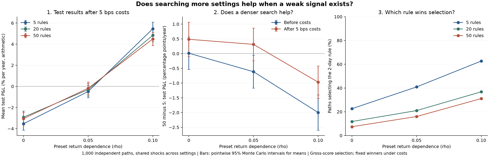

# Backtest selection bias

Do more momentum settings help when a weak signal exists?

The rule buys after positive past returns and sells short after negative ones. The experiment tries 5, 20 or 50 lookback windows, picks the best on the training period, then keeps that choice for the test period. Simulated returns range from pure noise (`rho=0`) to weak persistence (`rho=0.05` and `0.10`).

| Return dependence (`rho`) | 5 settings | 20 settings | 50 settings |
|---:|---:|---:|---:|
| 0.00 | -3.54% | -2.92% | -3.05% |
| 0.05 | -0.49% | -0.31% | -0.18% |
| 0.10 | 5.45% | 4.83% | 4.48% |

Average simulated test P&L after a 0.05% cost per unit traded (5 bps). Annual figures multiply average daily fixed-notional P&L by 252; they are not compounded or live returns.

At `rho=0.10`, the 50-setting search produces **0.97 percentage points/year less** net test P&L than the 5-setting search. The paired 95% interval is **[-1.52, -0.42]**. The other two paired intervals include zero, so this is not a general result that smaller searches work better.



All searches see the same return paths, so one search cannot benefit from a luckier simulated market. A separate control repeats the five rules ten times and gets exactly the same results at every `rho`: adding copies does not add different trading rules.

## Run

Tested with Python 3.12.

```bash
python -m venv .venv
source .venv/bin/activate
python -m pip install -r requirements.txt
python -m unittest -v
python study.py --historical
```

Outputs: `results.json` and `results.png`. Omit `--historical` for simulations only. Downloads and per-path results stay in ignored `.cache/`.

`strategy.py` handles positions, costs and selection; `study.py` runs the experiments. `test_strategy.py` contains 17 checks.

<details>
<summary>Method and assumptions</summary>

- 1,000 independent whole paths share Gaussian shocks across `rho = 0, 0.05, 0.10`. These preset values are not market estimates. All have 1% marginal daily volatility.
- `r[0] = shock[0]`; `r[t] = rho*r[t-1] + sqrt(1-rho**2)*shock[t]`, with independent Normal(0, 0.01 squared) shocks. Zero dependence exactly reproduces the original noise experiment.
- Paths have 252 warm-up, 756 selection and 756 forward-test days. Selection excludes test data; at nonzero `rho`, training and test returns are statistically dependent.
- Positions follow the sign of summed earlier returns. Nested, correlated candidate sets share paths, dates and the 2-252 day range. The smallest set includes the 2-day rule; larger sets fill the grid.
- Selection uses the highest training gross score, with ties broken by candidate order. The rule stays fixed for testing at 0, 1 and 5 bps per one-way turnover unit. Entry and liquidation incur costs; switching long to short costs two units. Each period starts and ends flat.

The main comparison is paired `50 minus 5` test net P&L at 5 bps. Intervals use mean +/- 1.96 standard errors across independent paths: pointwise Monte Carlo intervals, without simultaneous coverage or investment-risk interpretation.

Settings were fixed locally before the weak-signal runs. Seed 2026101607 had already been used for the noise experiment. This was not external preregistration.

The score is `sqrt(252) * daily mean / sample standard deviation`, with a zero risk-free benchmark. Under serial dependence it is descriptive, not a corrected annual Sharpe. Market-return and strategy-return dependence can differ. The stationary model need not describe real markets. P&L excludes financing and short-borrow fees. Selection uses gross scores, not net-cost optimisation. The project offers no new overfitting method or ready-to-trade strategy.

</details>

<details>
<summary>Simulation results</summary>

| `rho` | Settings | Selection score | Gross test P&L/year | Net at 5 bps/year | 2-day rule selected |
|---:|---:|---:|---:|---:|---:|
| 0.00 | 5 | 0.598 | -0.21% | -3.54% | 22.6% |
| 0.00 | 20 | 0.803 | 0.15% | -2.92% | 11.8% |
| 0.00 | 50 | 0.914 | -0.19% | -3.05% | 7.4% |
| 0.05 | 5 | 0.820 | 4.00% | -0.49% | 40.9% |
| 0.05 | 20 | 1.008 | 3.55% | -0.31% | 21.0% |
| 0.05 | 50 | 1.102 | 3.38% | -0.18% | 16.0% |
| 0.10 | 5 | 1.136 | 11.18% | 5.45% | 62.7% |
| 0.10 | 20 | 1.292 | 9.90% | 4.83% | 36.8% |
| 0.10 | 50 | 1.363 | 9.18% | 4.48% | 31.1% |

At `rho=0.05`, positive gross means become slightly negative after costs, with intervals including zero. At `rho=0.10`, expanding from 5 to 50 settings lowers gross P&L by 2.00 percentage points/year. Lower turnover saves 1.03 points in costs, leaving the 0.97-point net difference above.

The larger search selects the 2-day rule less often: 31.1% versus 62.7%. Other candidates can displace a useful short window, but selecting it is not a measure of finding the best strategy: costs can favour longer windows.

</details>

<details>
<summary>Historical example</summary>

The optional example uses the [Ken French value-weighted consumer-industry series](https://mba.tuck.dartmouth.edu/pages/faculty/ken.french/Data_Library/det_5_ind_port.html). Its series and split were fixed before inspecting results and remain unchanged.

| Settings | Selected lookback | 2000-2015 selection score | 2016-2025 test score |
|---:|---:|---:|---:|
| 5 | 252 days | 0.101 | 0.278 |
| 20 | 219 days | 0.311 | 0.468 |
| 50 | 235 days | 0.344 | 0.331 |

The 50-setting winner's gross arithmetic P&L was 5.97%/year, versus 13.51% passively, without risk matching. One split cannot establish the best search size or inherit simulation intervals. This revised research-portfolio snapshot is neither point-in-time data nor a tradeable ETF. `results.json` records its source date and SHA-256.

</details>

## Reading

- Bailey et al., [The Probability of Backtest Overfitting](https://www.davidhbailey.com/dhbpapers/backtest-prob.pdf). This project does not implement PBO/CSCV.
- Berkeley Stat 153/248, [AR Models](https://stat153.berkeley.edu/spring-2026/ar-models-notes/): stationary AR(1) covariance.
- Lo, [The Statistics of Sharpe Ratios](https://traders.berkeley.edu/papers/The-Statistics-of-Sharpe-Ratios.pdf): limits of square-root-of-time scaling.
